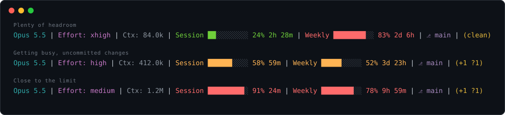

<div align="center">

# claude-statusline

**A compact, color-coded status line for [Claude Code](https://claude.com/claude-code).**<br>
Model, reasoning effort, context size, usage limits and git state, always visible under your prompt.




</div>

## Quick start

```bash
gh repo clone levgiorg/claude-statusline ~/claude-statusline
node ~/claude-statusline/install.js
```

Restart Claude Code. Done.

> Needs Node.js. Git is optional: outside a repository the line shows `no git`.

## What you see

| Segment | Example | Meaning |
|---|---|---|
| **Model** | `Opus 5.5` | Active model, with any trailing `(...)` suffix removed |
| **Effort** | `Effort: xhigh` | Current reasoning effort, follows `/effort` changes. Hidden when the model has no effort setting |
| **Context** | `Ctx: 84.0k` | Tokens in the context window (`k` and `M` suffixes) |
| **Session** | `Session ██░░░░░░░░ 24% 2h 28m` | 5-hour usage limit and time until it resets |
| **Weekly** | `Weekly ████████░░ 83% 2d 6h` | 7-day usage limit and time until it resets |
| **Git branch** | `⎇ main` | Current branch |
| **Git status** | `(+1 *2 ?3 !1)` or `(clean)` | Working tree summary, see below |

Session and Weekly need a Pro or Max plan and appear after the first reply of a session.

### Usage colors

The bars turn warmer as you approach a limit:

| Usage | Color |
|---|---|
| under 50% | green |
| 50% to 74% | orange |
| 75% and above | red |

### Git status symbols

| Symbol | Meaning |
|---|---|
| `+N` | staged changes |
| `*N` | unstaged changes |
| `?N` | untracked files |
| `!N` | merge conflicts |

## How it works

Claude Code runs the script after each update and pipes a JSON blob (model, effort, context window, rate limits) to its stdin. The script prints one line of ANSI-colored text, and Claude Code shows it as the status line.

- Zero dependencies, a single file: [`statusline-command.js`](statusline-command.js)
- Git calls have a 1 second timeout, so a slow repository cannot freeze the UI
- Missing or malformed input degrades to fewer segments instead of an error

## Install details

`install.js` does three things:

1. Copies `statusline-command.js` to `~/.claude/statusline-command.js`
2. Sets `statusLine` in `~/.claude/settings.json` to run that file with `node`
3. Saves your previous settings as `~/.claude/settings.json.bak`

If `~/.claude/settings.local.json` defines its own `statusLine`, it overrides this one. The installer warns you when that happens.

## Update

```bash
git -C ~/claude-statusline pull && node ~/claude-statusline/install.js
```

## Uninstall

1. Remove the `statusLine` block from `~/.claude/settings.json`, or restore `~/.claude/settings.json.bak`
2. Delete `~/.claude/statusline-command.js`
3. Restart Claude Code

## Troubleshooting

| Problem | Fix |
|---|---|
| Status line did not change | Restart Claude Code, then check `~/.claude/settings.local.json` for a competing `statusLine` |
| No `Session` / `Weekly` bars | Needs a Pro or Max plan, and shows only after the first reply |
| No `Effort` segment | The current model does not report an effort level |
| Install fails with "not valid JSON" | Fix the syntax error in the file the message names, then rerun |
| Boxes or `⎇` look wrong | Use a terminal font that includes block and symbol glyphs, such as a Nerd Font |

## Test it without Claude Code

```bash
echo '{"model":{"display_name":"Opus 5.5"},"effort":{"level":"high"}}' | node statusline-command.js
```
